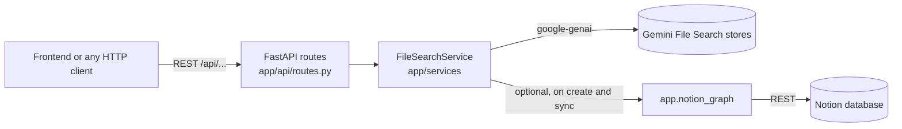

# Gemini File Search API

A small FastAPI service that puts an HTTP interface in front of Google's
[Gemini File Search](https://ai.google.dev/gemini-api/docs/file-search): create document
stores, upload files into them, and ask grounded questions with multi-turn history. The
answers come back as Markdown along with the source documents Gemini used.

It is the backend for the Gemini File Search frontend (a separate Next.js app), but any
HTTP client can use it. It can also seed a store from a Notion database: the Notion pages
are turned into a knowledge graph, and that graph is uploaded as a JSON document.

## How it fits together



- `app/api/routes.py` handles HTTP only: parsing requests, temp files for uploads and
  response models. Blocking SDK calls run in the threadpool.
- `app/services/file_search_service.py` talks to Gemini. Store names can be given as the
  full resource name (`fileSearchStores/abc123`), a display name, or a bare id.
- `app/notion_graph.py` reads a Notion database into a `networkx` graph. The service uses
  it, and it also runs on its own as a command-line tool.
- `app/main.py` turns upstream failures into HTTP errors (see [Errors](#errors)).

## Running it

You need a Gemini API key from [Google AI Studio](https://aistudio.google.com/apikey).

### With Docker

```bash
cp .env.example .env        # then set GOOGLE_API_KEY
docker compose up --build
```

The API listens on `http://localhost:8000`. Interactive docs are at `/docs` (Swagger UI)
and `/redoc`. Compose reads `.env` only if the file exists. Without a key, `/health` still
answers and every `/api` route returns 503.

### Locally

Python 3.13 (see `.python-version`):

```bash
python -m venv .venv && source .venv/bin/activate
pip install -r requirements.txt
cp .env.example .env        # then set GOOGLE_API_KEY
uvicorn app.main:app --reload
```

### Configuration

All settings come from environment variables or `.env`:

| Variable | Default | Purpose |
| --- | --- | --- |
| `GOOGLE_API_KEY` | none | Required for every `/api` route |
| `NOTION_TOKEN`, `NOTION_DATABASE_ID` | none | Optional. When both are set, new stores are seeded from Notion and `/sync` works |
| `DEFAULT_MODEL` | `gemini-3-flash-preview` | Model used when a query doesn't name one |
| `DEFAULT_STORE_DISPLAY_NAME` | `my-file-search-store` | Used when a create or sync request has no display name |
| `UPLOAD_POLL_INTERVAL_SECONDS` | `5` | How often to check whether an upload has finished ingesting |
| `UPLOAD_TIMEOUT_SECONDS` | `300` | How long an upload request waits before it reports "in progress" |
| `CORS_ORIGINS` | `*` | Comma-separated browser origins that may call the API |

## Endpoints

| Method and path | What it does |
| --- | --- |
| `GET /health` (also `GET /`) | Liveness check, needs no key |
| `GET /api/stores` | List stores |
| `POST /api/stores` | Create a store. If Notion is configured, also ingest the Notion graph |
| `POST /api/stores/{store}/files` | Upload one file (multipart field `file`, optional `?display_name=`) and wait for ingest |
| `POST /api/stores/{store}/query` | Ask a question grounded in the store, with optional history |
| `POST /api/stores/{store}/sync` | Replace the store with a new one built from fresh Notion data |
| `DELETE /api/stores/{store}` | Delete one store and its documents |
| `DELETE /api/stores` | Delete every store in the project |

`{store}` may contain slashes, so `fileSearchStores/abc123` can be used as is.

### Examples

These were captured from the app running against an in-memory fake of the Gemini client
(the same one the tests use), so the names and text are demo values.

Create a store, then upload a file into it:

```bash
curl -X POST localhost:8000/api/stores \
  -H 'Content-Type: application/json' -d '{"display_name": "Employee handbook"}'
```

```json
{
  "store": {
    "name": "fileSearchStores/store-1",
    "display_name": "Employee handbook",
    "create_time": "2026-11-09T12:00:00+00:00"
  },
  "ingest": null
}
```

`ingest` is `null` because Notion isn't configured, so the store starts empty.

```bash
curl -X POST localhost:8000/api/stores/fileSearchStores/store-1/files -F file=@leave-policy.md
```

```json
{
  "operation_name": "fileSearchStores/store-1/upload/operations/op-1",
  "done": true,
  "message": "File uploaded and ingested"
}
```

If the file uploads without a `display_name`, the document takes the uploaded file's name.
If ingest is still running after `UPLOAD_TIMEOUT_SECONDS`, you get `"done": false` and
`"File upload in progress"`.

Ask a follow-up question. History roles must be `user` or `model`:

```bash
curl -X POST localhost:8000/api/stores/fileSearchStores/store-1/query \
  -H 'Content-Type: application/json' -d '{
    "prompt": "And part-time?",
    "conversation_history": [
      {"role": "user", "content": "How much annual leave do I get?"},
      {"role": "model", "content": "Full-time staff get 25 days."}
    ]
  }'
```

```json
{
  "text": "## Annual leave\n\n- Full-time staff get **25 days** a year.\n- Part-time staff accrue leave pro rata.",
  "sources": [
    { "title": "leave-policy.md", "uri": null, "chunk_id": null }
  ]
}
```

Without a `system_prompt`, the service adds a short instruction to the prompt asking for
Markdown with sections, bullet points and image links. With one, the `system_prompt` is
passed to Gemini as the system instruction, and the prompt is sent unchanged.

### Errors

Errors use FastAPI's usual `{"detail": "..."}` shape:

| Situation | Status |
| --- | --- |
| `GOOGLE_API_KEY` missing, or `/sync` called without Notion settings | 503 |
| Gemini says 400, 404 or 429 | same status, `"Gemini API error: <message>"` |
| Any other Gemini error, or a Notion request failure | 502 |
| Invalid request body (e.g. unknown history role) | 422 |

```json
{ "detail": "Gemini API error: Resource has been exhausted (e.g. check quota)." }
```

## The Notion knowledge graph

`app/notion_graph.py` reads a Notion database that describes a product as a tree of
components, each with optional knowledge-base articles. It expects these properties:

- `Name` (the title)
- `Type` (select)
- `Parent item` (relation to the same database)
- `KB Articles` (relation to article pages)
- `Aliases` (comma-separated text)

Other properties are copied onto the node as they are.

The graph has three kinds of edges:

- `PARENT_OF`, from the `Parent item` relation.
- `HAS_KB_ARTICLE`, linking to article pages. The service fetches these pages and stores
  their body text as Markdown-like text.
- `ALIAS_OF`, between rows that share an alias. This edge is skipped when the two rows
  are already parent and child.

When a store is created or synced, the graph is written to a temporary JSON file
(`{"nodes": [...], "edges": [...]}`), uploaded, and deleted.

To build the same graph by hand:

```bash
NOTION_TOKEN=... NOTION_DATABASE_ID=... python -m app.notion_graph \
  --output knowledge_graph.json --gexf knowledge_graph.gexf --show "Some component"
```

This prints node and edge counts. `--gexf` writes a file you can open in Gephi, and
`--show` prints one node with its path, children and articles.

Sync creates a new store, so the store name changes. Clients should use the name returned
in the response.

## Development

```bash
pip install -r requirements-dev.txt
pytest
ruff check . && ruff format --check .
```

The tests never reach Google or Notion. `tests/fakes.py` is an in-memory stand-in for
the parts of `google.genai.Client` the service uses. `tests/notion_fixtures.py` stands in
for the Notion REST API with a four-page demo workspace. The suite covers every route,
the error mapping, the Notion pagination and parsing, and the graph rules described above.

Dependencies: `requirements.in` lists the direct dependencies. `requirements.txt` is the
frozen result of installing them into a clean Python 3.13 environment.

## License

MIT, see [LICENSE](LICENSE).
